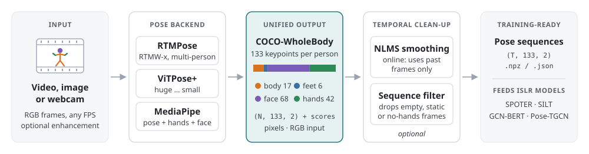

# WholeBodyPose

One interface for RTMPose, ViTPose+ and MediaPipe that always returns the 133 COCO-WholeBody
keypoints, plus the video pipeline that turns sign language videos into training-ready pose sequences
(ICMV 2025, Proceedings of SPIE).

[](https://cristianlazoquispe.github.io/WholebodyPoseEstimation/static/paper/WholeBodyPose_ICMV2025.pdf)
[](https://cristianlazoquispe.github.io/WholebodyPoseEstimation/)
[](https://huggingface.co/spaces/CristianLazoQuispe/WholeBodyPoseDemo)
[](https://huggingface.co/datasets/CristianLazoQuispe/pose-action-recognition)
[](https://github.com/CristianLazoQuispe/WholebodyPoseEstimation/actions/workflows/ci.yml)
[](LICENSE)



## Installation

```bash
pip install "wholebodypose[all] @ git+https://github.com/CristianLazoQuispe/WholebodyPoseEstimation.git"
```

| Extra | For |
|:--|:--|
| `[rtmpose]`, `[vitpose]`, `[mediapipe]` | one backend only (`[gpu]` adds ONNX Runtime CUDA for RTMPose) |
| `[all]` | the three backends, NLMS filtering and bundled ffmpeg |

Weights download on first use. GPU, from source, Docker: [docs/guide/installation.md](docs/guide/installation.md).

## Usage

**Image**

```python
import cv2
from wholebodypose import PoseEstimator

est = PoseEstimator("rtmpose")  # or "vitpose", "mediapipe"
keypoints, scores = est.predict_image("data/images/image.jpg")  # (N, 133, 2) pixels, (N, 133)
cv2.imwrite("image_pose.png", est.draw(cv2.imread("data/images/image.jpg"), keypoints, scores))
```

**Video**

```python
from wholebodypose import PoseEstimator, save_poses

est = PoseEstimator("rtmpose")
res = est.process_video("data/videos/videoTest.mp4", "outputs/", video_processing_fps=15)
print(res["total_keypoints"].shape, res["filepath_result"])  # (T, 133, 2), outputs/videoTest_rtmpose.mp4
save_poses("outputs/videoTest.npz", res["total_keypoints"], res["total_scores"], fps=res["processing_fps"])
```

```bash
wholebodypose video data/videos/videoTest.mp4 -b rtmpose --fps 15   # -> outputs/videoTest_rtmpose.{mp4,npz}
```

## Links

- Documentation: [docs/](docs/README.md) (backends, keypoint layout, video pipeline, filtering, weights)
- Datasets: [pose-action-recognition](https://huggingface.co/datasets/CristianLazoQuispe/pose-action-recognition) on the Hugging Face Hub ([schema and loading](docs/datasets/README.md))
- Demo: [WholeBodyPoseDemo](https://huggingface.co/spaces/CristianLazoQuispe/WholeBodyPoseDemo), no install needed
- Project page: [cristianlazoquispe.github.io/WholebodyPoseEstimation](https://cristianlazoquispe.github.io/WholebodyPoseEstimation/)

## Citation

```bibtex
@inproceedings{lazo2026wholebodypose,
  title        = {WholeBodyPose: a unified end-to-end framework for sign language recognition and pose-based training data},
  author       = {Lazo-Quispe, Cristian and Castro-Cruz, Renato and Bejarano, Gissella and Salazar-Espinosa, Mauricio},
  booktitle    = {Eighteenth International Conference on Machine Vision (ICMV 2025)},
  volume       = {14114},
  pages        = {69--79},
  year         = {2026},
  organization = {SPIE}
}
```

Please also cite the backend you use: [docs/guide/backends.md#citing-the-backends](docs/guide/backends.md#citing-the-backends).

## License

Code: [MIT](LICENSE); model weights keep their original licenses (Apache-2.0, see [THIRD_PARTY.md](THIRD_PARTY.md)).
