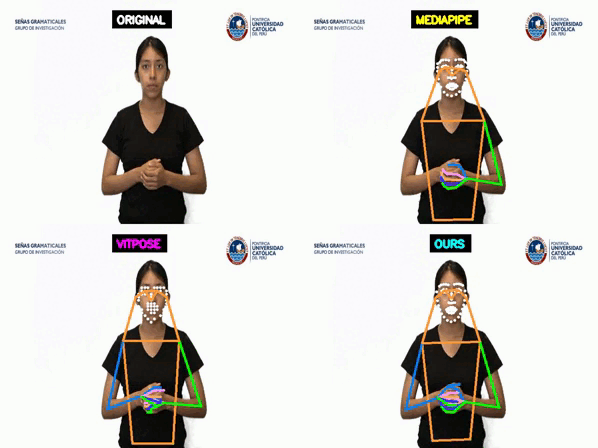

<div align="center">

# WholeBodyPose

### A Unified End-to-End Framework for Sign Language Recognition and Pose-Based Training Data

**Cristian Lazo-Quispe**<sup>1</sup>, **Renato Castro-Cruz**<sup>1</sup>, **Mauricio Salazar-Espinosa**<sup>2</sup>, **Gissella Bejarano**<sup>3</sup>

<sup>1</sup>Universidad Nacional de Ingeniería, Lima, Peru · <sup>2</sup>Pontificia Universidad Católica del Perú · <sup>3</sup>Marist University, New York, USA

*18th International Conference on Machine Vision (ICMV 2025) · Proceedings of SPIE*

[](https://cristianlazoquispe.github.io/WholebodyPoseEstimation/)
[](https://cristianlazoquispe.github.io/WholebodyPoseEstimation/static/paper/WholeBodyPose_ICMV2025.pdf)
[](https://huggingface.co/spaces/CristianLazoQuispe/WholeBodyPoseDemo)
[](https://huggingface.co/datasets/CristianLazoQuispe/pose-action-recognition)
[](https://huggingface.co/CristianLazoQuispe/wholebodypose-weights)
<br>
[](https://github.com/CristianLazoQuispe/WholebodyPoseEstimation/actions/workflows/ci.yml)
[](pyproject.toml)
[](LICENSE)



</div>

## TL;DR

Every pose estimator speaks its own dialect: MediaPipe returns 543 landmarks, RTMPose and ViTPose
return COCO-WholeBody, and each has its own thresholds, coordinate conventions and failure modes.
**WholeBodyPose** puts **RTMPose (RTMW)**, **ViTPose+** and **MediaPipe** behind one interface that
always returns the **133 COCO-WholeBody keypoints** (body, feet, face, both hands), plus the
video pipeline, temporal filtering (NLMS) and visualization needed to turn raw sign language
videos into training-ready pose sequences.

```python
from wholebodypose import PoseEstimator

est = PoseEstimator("rtmpose")  # or "vitpose", "mediapipe"
keypoints, scores = est.predict_image("person.jpg")  # (N, 133, 2), (N, 133)
res = est.process_video("sign.mp4", "outputs/")  # res["total_keypoints"]: (T, 133, 2)
```

## Backends

| Backend | Model | People | Runs on | Install extra |
|:--|:--|:-:|:--|:--|
| `rtmpose` | YOLOX-m + RTMW-x 384×288 (OpenMMLab) | multi | ONNX Runtime CPU / CUDA | `[rtmpose]` (+ `[gpu]`) |
| `vitpose` | ViTPose+ huge/large/base/small, top-down | single · multi with YOLOX crops | PyTorch CPU / CUDA | `[vitpose]` (+ `[rtmpose]` for multi) |
| `mediapipe` | BlazePose heavy + Hands + Face landmarker | single · multi (`max_people`) | CPU | `[mediapipe]` |

Multi-person mode works with every backend and adds stable person IDs in videos:

```python
est = PoseEstimator("vitpose", multiperson=True, max_people=4)
res = est.process_video(
    "dance.mp4", "outputs/"
)  # res["total_keypoints"][t]: (N_t, 133, 2), res["track_ids"][t]: (N_t,)
```

All backends take an **RGB** image and return `float32` pixel coordinates in COCO-WholeBody order;
undetected keypoints are `(0, 0)` with score `0`. Default settings reproduce the paper
(`PoseEstimator(backend)`), and any backend argument can be overridden, e.g.
`PoseEstimator("rtmpose", mode="lightweight")`. See [docs/guide/backends.md](docs/guide/backends.md).

## Installation

```bash
pip install "wholebodypose[all] @ git+https://github.com/CristianLazoQuispe/WholebodyPoseEstimation.git"
```

Pick only what you need: `[rtmpose]`, `[vitpose]`, `[mediapipe]`, `[filters]` (NLMS), `[video]`
(bundled ffmpeg for browser-playable MP4s), `[gpu]` (ONNX Runtime CUDA). The core package only
depends on NumPy and OpenCV. Model weights are downloaded on first use to
`~/.cache/wholebodypose` (override with `WHOLEBODYPOSE_HOME`), from our
[Hugging Face mirror](https://huggingface.co/CristianLazoQuispe/wholebodypose-weights) with a fallback to the
original upstream URLs.

From source:

```bash
git clone https://github.com/CristianLazoQuispe/WholebodyPoseEstimation.git
cd WholebodyPoseEstimation
python -m venv .venv && source .venv/bin/activate
pip install -e ".[all,dev]"
pytest -m "not slow"        # unit tests, no downloads
pytest -m slow              # real backends on a real image (downloads weights)
```

## Quick start

**Command line**

```bash
wholebodypose backends                                   # list backends
wholebodypose image data/images/image.jpg -b mediapipe   # -> outputs/image_mediapipe.{png,json}
wholebodypose video data/videos/videoTest.mp4 -b rtmpose --fps 15
                                                         # -> outputs/videoTest_rtmpose.{mp4,npz}
wholebodypose download                                   # pre-fetch every weight
```

**Python**

```python
import cv2
from wholebodypose import PoseEstimator, save_poses, load_poses
from wholebodypose.filters.sequence import PoseSequenceFilter

est = PoseEstimator("rtmpose", device="cuda")

# image
rgb = cv2.cvtColor(cv2.imread("person.jpg"), cv2.COLOR_BGR2RGB)
keypoints, scores = est.predict(rgb)
cv2.imwrite("drawn.png", est.draw(cv2.imread("person.jpg"), keypoints, scores))

# video -> training-ready sequence
res = est.process_video("sign.mp4", "outputs/", video_processing_fps=15)
save_poses("sign.npz", res["total_keypoints"], res["total_scores"], fps=res["processing_fps"])

# drop empty / static / hands-not-visible frames
flt = PoseSequenceFilter(left_hand_indices=range(91, 112), right_hand_indices=range(112, 133))
clean, masks = flt.apply_all_filters(res["total_keypoints"])
```

More in [docs/](docs/README.md) and [examples/](examples/).

## Pose datasets

Pose sequences extracted with WholeBodyPose for six isolated sign language recognition benchmarks
are on the Hugging Face Hub: [`CristianLazoQuispe/pose-action-recognition`](https://huggingface.co/datasets/CristianLazoQuispe/pose-action-recognition).

| Dataset | Classes | Samples | Language | Split |
|:--|:-:|:-:|:--|:--|
| WLASL100 | 100 | 2,038 | American SL 🇺🇸 | official |
| WLASL300 | 300 | 5,117 | American SL 🇺🇸 | official |
| MSASL100 | 100 | 5,721 | American SL 🇺🇸 | official |
| ASL-Citizen | 2,731 | 83,399 | American SL 🇺🇸 | official |
| LSA64 | 64 | 3,200 | Argentinian SL 🇦🇷 | signer-independent |
| PUCP-DGI30 | 30 | 715 | Peruvian SL 🇵🇪 | stratified random |

The pose files are derived data; the original videos keep the licenses of their authors.

## Demo

Try it without installing anything: **[🤗 WholeBodyPoseDemo](https://huggingface.co/spaces/CristianLazoQuispe/WholeBodyPoseDemo)**.
Upload a video or an image, pick a backend and get the skeleton overlay plus the keypoints.
The Space is built from [`hf/space/`](hf/space) by CI; run it locally with

```bash
pip install -e ".[demo]" && python hf/space/app.py   # [demo] includes all three backends
```

## Repository layout

```
src/wholebodypose/     library: api, models/{rtmpose,vitpose,mediapipe}, video, filters, io, weights, cli
tests/                 pytest suite (unit tests + `slow` real-backend tests)
examples/              short scripts
docs/                  guides (install, backends, keypoint layout, video pipeline)
website/               project page, deployed to GitHub Pages by .github/workflows/pages.yml
hf/                    Hugging Face: Space app, weight-mirror and dataset-card tooling
docker/                CPU/GPU images
```

## Citation

If you use WholeBodyPose, please cite:

```bibtex
@inproceedings{lazo2025wholebodypose,
  title     = {WholeBodyPose: A Unified End-to-End Framework for Sign Language Recognition and Pose-Based Training Data},
  author    = {Lazo-Quispe, Cristian and Castro-Cruz, Renato and Salazar-Espinosa, Mauricio and Bejarano, Gissella},
  booktitle = {Eighteenth International Conference on Machine Vision (ICMV 2025)},
  series    = {Proceedings of SPIE},
  publisher = {SPIE},
  year      = {2025}
}
```

<details>
<summary>Please also cite the backend you use</summary>

```bibtex
@article{jiang2024rtmw,
  title   = {RTMW: Real-Time Multi-Person 2D and 3D Whole-body Pose Estimation},
  author  = {Jiang, Tao and Xie, Xinchen and Li, Yining},
  journal = {arXiv preprint arXiv:2407.08634},
  year    = {2024}
}
@article{xu2024vitpose++,
  title   = {ViTPose++: Vision Transformer for Generic Body Pose Estimation},
  author  = {Xu, Yufei and Zhang, Jing and Zhang, Qiming and Tao, Dacheng},
  journal = {IEEE Transactions on Pattern Analysis and Machine Intelligence},
  volume  = {46},
  number  = {2},
  pages   = {1212--1230},
  year    = {2024},
  doi     = {10.1109/TPAMI.2023.3330016}
}
@article{lugaresi2019mediapipe,
  title   = {MediaPipe: A Framework for Building Perception Pipelines},
  author  = {Lugaresi, Camillo and others},
  journal = {arXiv preprint arXiv:1906.08172},
  year    = {2019}
}
@inproceedings{jin2020whole,
  title     = {Whole-Body Human Pose Estimation in the Wild},
  author    = {Jin, Sheng and Xu, Lumin and Xu, Jin and Wang, Can and Liu, Wentao and Qian, Chen and Ouyang, Wanli and Luo, Ping},
  booktitle = {ECCV},
  year      = {2020}
}
```
</details>

## Acknowledgements

WholeBodyPose builds on [rtmlib](https://github.com/Tau-J/rtmlib) / [MMPose](https://github.com/open-mmlab/mmpose),
[onepose](https://github.com/developer0hye/onepose) / [ViTPose](https://github.com/ViTAE-Transformer/ViTPose),
[MediaPipe](https://github.com/google-ai-edge/mediapipe) and [padasip](https://github.com/matousc89/padasip).
See [THIRD_PARTY.md](THIRD_PARTY.md) for licenses.

## License

Code: [MIT](LICENSE). Model weights keep their original licenses (all Apache-2.0, see [THIRD_PARTY.md](THIRD_PARTY.md)).
