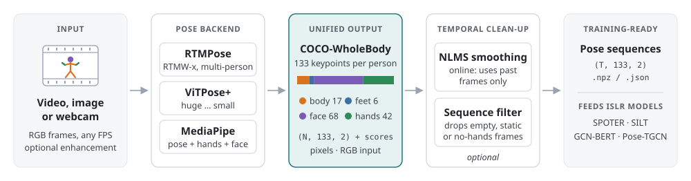

# Documentation

The repository [README](../README.md) is the short overview. The guides below go one level deeper; every
default and signature they quote is taken from the code in [`src/wholebodypose/`](../src/wholebodypose).

## What WholeBodyPose is

Every pose estimator speaks its own dialect: MediaPipe returns 543 landmarks, RTMPose and ViTPose
return COCO-WholeBody, and each has its own thresholds, coordinate conventions and failure modes.
WholeBodyPose puts **RTMPose (RTMW)**, **ViTPose+** and **MediaPipe** behind one interface that
always returns the **133 COCO-WholeBody keypoints** (body, feet, face, both hands), plus the video
pipeline, temporal filtering (NLMS) and visualization needed to turn raw sign language videos into
training-ready pose sequences.

All backends take an **RGB** image and return `float32` pixel coordinates in COCO-WholeBody order;
undetected keypoints are `(0, 0)` with score `0`. Default settings reproduce the paper
(`PoseEstimator(backend)`), and any backend argument can be overridden, e.g.
`PoseEstimator("rtmpose", mode="lightweight")`.



> **Please cite.** If you use WholeBodyPose, cite the paper: Lazo-Quispe, Castro-Cruz, Bejarano, Salazar-Espinosa, *WholeBodyPose: a
> unified end-to-end framework for sign language recognition and pose-based training data*, Proc. SPIE
> 14114 (ICMV 2025), doi:[10.1117/12.3096312](https://doi.org/10.1117/12.3096312)
> ([BibTeX](../README.md#citation)), plus the backend you used and, for the pose datasets, the source
> dataset of every subset ([how to cite](LICENSING.md#how-to-cite)).

## Map

```text
docs/
├── guide/
│   ├── installation.md     extras, CPU / GPU, from source, Docker, demo app
│   ├── quickstart.md       command line and Python in five minutes
│   ├── backends.md         RTMPose, ViTPose, MediaPipe: models, paper defaults, multi-person, thresholds,
│   │                       speed, backend citations
│   ├── keypoints.md        COCO-WholeBody 133 layout and the 135-point variant
│   ├── video-pipeline.md   Video2Pose options and outputs, save/load formats, filtering
│   ├── onnx.md             ONNX Runtime models: vendored RTMPose code, ViTPose graph, validation
│   └── weights.md          Hugging Face mirror, cache, offline use
├── release.md              maintainers: GitHub Release, PyPI Trusted Publishing setup
├── datasets/
│   ├── README.md           ISLR pose datasets: HDF5 schema, loading, rebuilding from videos
│   └── wlasl.md            WLASL provenance and processing
├── LICENSING.md            licenses of the code, datasets and model weights, and how to cite
└── assets/                 figures used by the README, the guides and the project page
                            (pipeline.svg: the pipeline figure of the project page)
```

| I want to… | read |
|:--|:--|
| try it without installing anything | the [demo Space](https://huggingface.co/spaces/CristianLazoQuispe/WholeBodyPoseDemo) |
| install the package (CPU, GPU, one backend, Docker) | [guide/installation.md](guide/installation.md) |
| get keypoints from an image or a video right now | [guide/quickstart.md](guide/quickstart.md), [`examples/`](../examples/README.md) |
| choose a backend, or know what the defaults are | [guide/backends.md](guide/backends.md) |
| detect several people and track them in a video | [guide/backends.md#multi-person](guide/backends.md#multi-person) |
| know which index is the left wrist / the right hand / the face | [guide/keypoints.md](guide/keypoints.md) |
| turn sign language videos into training sequences | [guide/video-pipeline.md](guide/video-pipeline.md) |
| smooth keypoints (NLMS) or drop bad frames | [guide/video-pipeline.md#filtering](guide/video-pipeline.md#filtering) |
| know how the ONNX models are run and validated | [guide/onnx.md](guide/onnx.md) |
| run on a machine without internet, or mirror the weights | [guide/weights.md](guide/weights.md) |
| use the pose datasets of the paper | [datasets/README.md](datasets/README.md), the [dataset card](https://huggingface.co/datasets/CristianLazoQuispe/pose-action-recognition) |
| rebuild the pose datasets from the raw videos | [datasets/README.md#rebuilding-from-videos](datasets/README.md#rebuilding-from-videos) |
| run the demo app locally | [guide/installation.md#demo-app](guide/installation.md#demo-app) |
| add a backend or send a fix | [CONTRIBUTING.md](../CONTRIBUTING.md) |
| know what each license allows | [LICENSING.md](LICENSING.md) |
| cite the paper, the backend or a source dataset | [LICENSING.md#how-to-cite](LICENSING.md#how-to-cite), [guide/backends.md#citing-the-backends](guide/backends.md#citing-the-backends) |
| read the paper | the [project page](https://cristianlazoquispe.github.io/WholebodyPoseEstimation/) |

## Repository layout

```text
src/wholebodypose/     library: api, models/{rtmpose,vitpose,mediapipe}, video, filters, io, weights, cli
tests/                 pytest suite (unit tests + `slow` real-backend tests)
examples/              image, video and dataset scripts
docs/                  guides (install, backends, keypoint layout, video pipeline) and datasets
website/               project page, deployed to GitHub Pages by .github/workflows/pages.yml
hf/                    Hugging Face: Space app, weight-mirror and dataset-card tooling
docker/                CPU/GPU images
```
