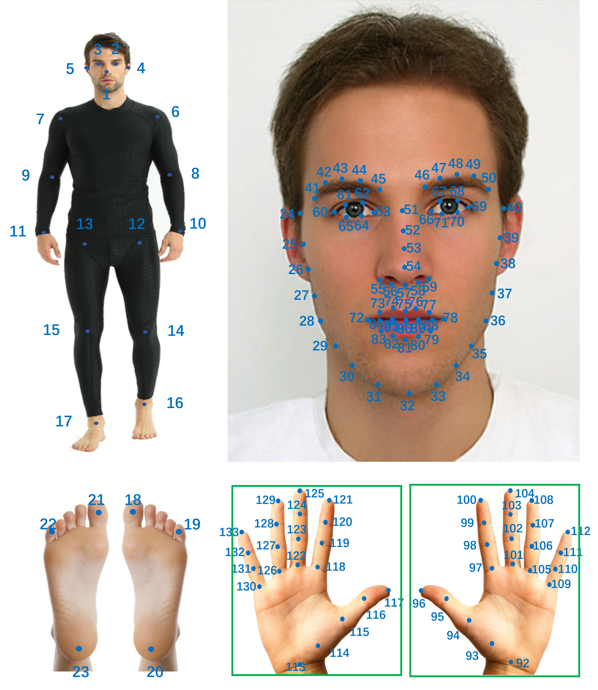

# Keypoint layout

Every backend returns the **133 keypoints of COCO-WholeBody** ([Jin et al., ECCV 2020](https://github.com/jin-s13/COCO-WholeBody)),
in pixel coordinates `(x, y)` of the input image. "Left" and "right" are the **person's** left and right.

<p align="center"></p>

## Index ranges

| Part | Indices | Count | Python slice |
|:--|:--|:-:|:--|
| body | 0-16 | 17 | `0:17` |
| feet | 17-22 | 6 | `17:23` |
| face | 23-90 | 68 | `23:91` |
| left hand | 91-111 | 21 | `91:112` |
| right hand | 112-132 | 21 | `112:133` |

```python
BODY, FEET, FACE = slice(0, 17), slice(17, 23), slice(23, 91)
LEFT_HAND, RIGHT_HAND = slice(91, 112), slice(112, 133)
left_hand = keypoints[0, LEFT_HAND]        # (21, 2) for the first person
```

### Body (0-16) — the 17 COCO keypoints

| 0 nose | 1 left eye | 2 right eye | 3 left ear | 4 right ear |
|:--|:--|:--|:--|:--|
| **5** left shoulder | **6** right shoulder | **7** left elbow | **8** right elbow | **9** left wrist |
| **10** right wrist | **11** left hip | **12** right hip | **13** left knee | **14** right knee |
| **15** left ankle | **16** right ankle | | | |

### Feet (17-22)

| 17 left big toe | 18 left small toe | 19 left heel | 20 right big toe | 21 right small toe | 22 right heel |
|:--|:--|:--|:--|:--|:--|

### Face (23-90)

The 68 facial landmarks of the iBUG 300-W convention, `face-0` … `face-67`, so COCO index = 23 + face
index: jaw line 23-39, eyebrows 40-49, nose 50-58, eyes 59-70, mouth 71-90.

### Hands (91-111 left, 112-132 right)

Each hand has 21 points: the root (wrist of the hand model) and four joints per finger, from the
palm to the tip.

| Offset | Points | Left | Right |
|:--|:--|:--|:--|
| 0 | hand root | 91 | 112 |
| 1-4 | thumb | 92-95 | 113-116 |
| 5-8 | forefinger | 96-99 | 117-120 |
| 9-12 | middle finger | 100-103 | 121-124 |
| 13-16 | ring finger | 104-107 | 125-128 |
| 17-20 | pinky | 108-111 | 129-132 |

Names, colors and skeleton links are in `wholebodypose.utils.coco133.coco133`
(`keypoint_info`, `skeleton_info`), the same metadata used by OpenMMLab.

## The 135-point variant

The pose datasets released with the paper
([`pose-action-recognition`](https://huggingface.co/datasets/CristianLazoQuispe/pose-action-recognition))
and the recognition models use **135 keypoints**: the 133 above plus two virtual points that give the
skeleton an OpenPose-like spine.

| Index | Name | Definition |
|:--|:--|:--|
| 133 | `middle_chest` (neck) | midpoint of the shoulders, `(kp[5] + kp[6]) / 2` |
| 134 | `middle_hip` (pelvis) | midpoint of the hips, `(kp[11] + kp[12]) / 2` |

Their scores are the mean of the two parent scores. Two extra links (`middle_chest → nose`,
`middle_chest → middle_hip`) replace the ear-shoulder and shoulder-hip links when drawing.

Where it appears in the library:

- `DrawerPose(mode_coco=False)`, `PoseEstimator(..., mode_coco=False)`, `Video2Pose(mode_coco=False)`
  and `wholebodypose ... --style openpose135` **draw** the 135-point skeleton. The returned keypoints
  stay `(N, 133, 2)`.
- `FilteringNLMS(num_keypoints=135)` is the default, matching the dataset layout; pass
  `num_keypoints=133` for sequences produced by the library.

To build the 135-point array from library output:

```python
import numpy as np

def to135(keypoints, scores):
    """(..., 133, 2), (..., 133) -> (..., 135, 2), (..., 135)."""
    neck = (keypoints[..., 5, :] + keypoints[..., 6, :]) / 2
    pelvis = (keypoints[..., 11, :] + keypoints[..., 12, :]) / 2
    k = np.concatenate([keypoints, neck[..., None, :], pelvis[..., None, :]], axis=-2)
    s = np.concatenate([scores, ((scores[..., 5] + scores[..., 6]) / 2)[..., None],
                        ((scores[..., 11] + scores[..., 12]) / 2)[..., None]], axis=-1)
    return k, s
```

## MediaPipe

MediaPipe's own landmarks (33 pose, 21 per hand, 468/478 face mesh) are mapped to the layout above
by the `mediapipe` backend; reference figures are in [`docs/assets/mediapipe/`](../assets/mediapipe)
and the mapping is described in [backends.md](backends.md#mediapipe-mediapipe).
